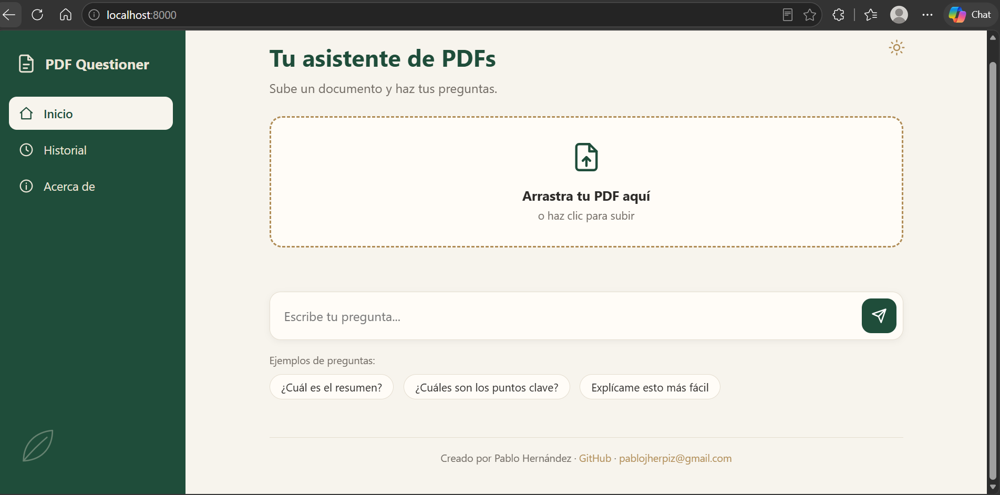
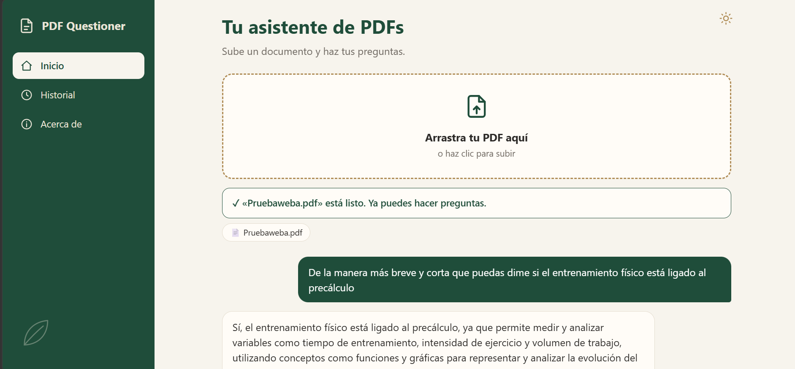
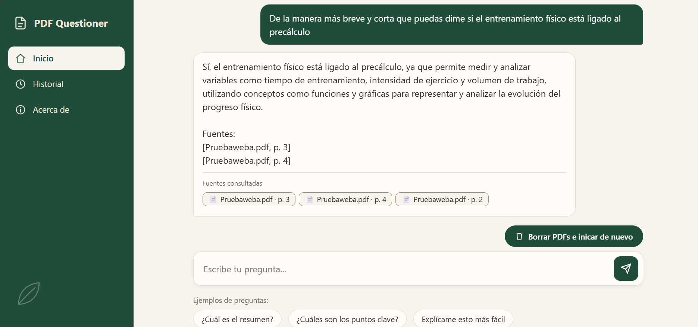

# PDF Questioner · Asistente de estudio con RAG

Sube tus PDFs, haz preguntas y recibe respuestas basadas **solo en tus documentos**, citando archivo y página. Funciona en local con Ollama: tus archivos nunca salen de tu computadora.

## Vista previa

**Interfaz al abrir:**



**Funcionando, con un PDF cargado y una pregunta:**





## Cómo funciona

```
PDF → fragmentos → embeddings → ChromaDB → búsqueda → LLM → respuesta con fuentes
```

1. Se lee el PDF y se divide en fragmentos de 800 caracteres con solapamiento de 150.
2. Cada fragmento se convierte en un vector (modelo multilingüe `paraphrase-multilingual-MiniLM-L12-v2`) y se guarda en ChromaDB.
3. Ante una pregunta se buscan los 4 fragmentos más parecidos.
4. Esos fragmentos y la pregunta se envían a `llama3.2` (Ollama), que responde solo con ese contexto.

## Tecnologías

Python · FastAPI · ChromaDB · sentence-transformers · pypdf · Ollama (llama3.2) · pytest · Docker · GitHub Actions · HTML/CSS/JS

## Requisitos

- Python 3.11 o superior
- [Ollama](https://ollama.com) instalado, con el modelo: `ollama pull llama3.2`
- **8 GB de RAM o más** recomendados (con menos puede ir muy lento)

## Instalación y uso

```
git clone https://github.com/pablojherpiz/asistente-estudio.git
cd asistente-estudio
python -m venv .venv
.venv\Scripts\activate
pip install -r requirements.txt
uvicorn app.main:app --reload
```

Abre http://localhost:8000. La primera vez se descarga el modelo de embeddings (varios cientos de MB).

## Docker

```
docker build -t asistente-estudio .
docker run -p 8000:8000 -e OLLAMA_HOST=http://host.docker.internal:11434 asistente-estudio
```

Ollama debe estar corriendo en tu equipo.

## Tests

```
pytest
```

Los tests usan mocks, así que no necesitan Ollama ni el modelo de embeddings. Se ejecutan automáticamente en GitHub Actions.

## Decisiones técnicas

- **ChromaDB**: base vectorial sin servidor, persistente en disco y simple de integrar.
- **Embeddings locales**: sin costo ni claves de API, y con soporte para español.
- **Carga perezosa del modelo**: los tests y el arranque son rápidos porque el modelo se carga solo al usarse.
- **Host de Ollama configurable** (`OLLAMA_HOST`): el mismo código funciona en local y en Docker.

## Limitaciones

- Solo lee PDFs con texto; los escaneados como imagen no funcionan.
- La búsqueda siempre devuelve 4 fragmentos, aunque no sean relevantes.
- llama3.2 es un modelo pequeño y a veces no respeta el formato de cita; la lista de fuentes la arma el código y es la referencia fiable.
- Un solo conjunto de documentos compartido, sin usuarios ni sesiones.

## Mejoras futuras

Streaming de respuestas, historial de conversación, soporte para .docx y .txt, chunking por párrafos, evaluación con preguntas de respuesta conocida y opción de usar la API de Claude.

## Autor

Pablo Hernández · [GitHub](https://github.com/pablojherpiz)